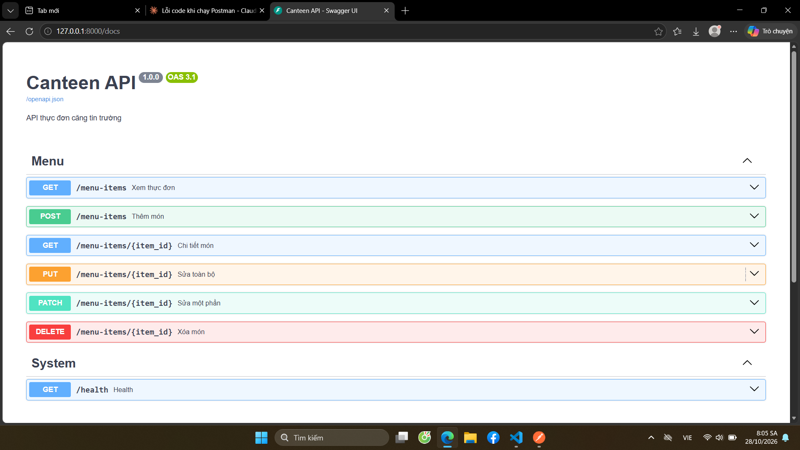
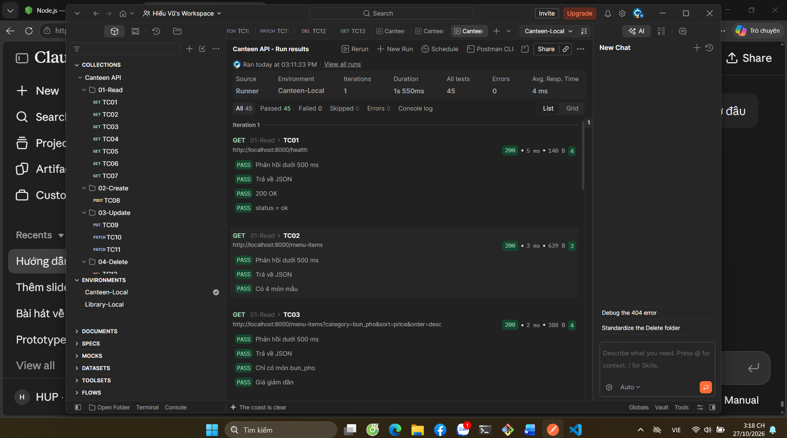
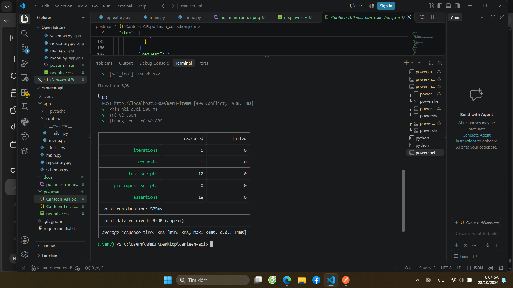

# Canteen API

API thực đơn căng tin trường, xây dựng bằng FastAPI. Hiện thực 6 endpoint CRUD, kiểm thử bằng Postman và Newman.

## Cài đặt và chạy

```powershell
python -m venv .venv
.venv\Scripts\Activate.ps1
pip install -r requirements.txt
python -m uvicorn app.main:app --reload
```

Mở http://127.0.0.1:8000/docs để xem Swagger.

## Cấu trúc

```
app/
  main.py          khởi tạo ứng dụng, /health
  schemas.py       định dạng dữ liệu vào/ra
  repository.py    lưu trữ trong bộ nhớ
  routers/menu.py  endpoint và quy tắc nghiệp vụ
docs/              design.md và ảnh minh chứng
postman/           collection, environment, negative.csv
```

## Kiểm thử

Khởi động lại server trước mỗi lần chạy để dữ liệu về 4 món mẫu.

```powershell
npx newman run postman/Canteen-API.postman_collection.json -e postman/Canteen-Local.postman_environment.json --folder 01-Read --folder 02-Create --folder 03-Update --folder 04-Delete
npx newman run postman/Canteen-API.postman_collection.json -e postman/Canteen-Local.postman_environment.json --folder 05-Data-driven -d postman/negative.csv
```

## Ảnh minh chứng

**Swagger**



**Postman Runner (13 test case, 100% Passed)**



**Newman (failed = 0)**

